# Student Marketplace

CS344 Web Engineering — Assignment 1 (`Annan Khan`, CMS `506644`, `BESE15-B`).

A browser-only campus marketplace built with **semantic HTML, CSS, and vanilla JavaScript** (no framework, bundler, or backend). Students can browse goods, offer services, post wanted requests, filter by category and price range, bookmark saved items, upload listing photos, and manage owned listings across review lifecycle states.

---

## Assigned Idea & Rule

- **Assigned Idea #16**: *Student Marketplace Listings* (from the CS344 41-topic project bank, carried continuously across Assignment 1 client prototype -> Assignment 2 PHP/PDO -> Assignment 3 React/Express/MongoDB).
- **Assigned Instructor Variant / Rule**: Supports **three listing kinds** (`Goods`, `Services` with rate units like per-hour/per-task, and `Wanted` notices with optional flexible budgets), category filtering, saved bookmarks, moderation/review lifecycle states (`Active`, `Pending review`, `Rejected` with reason, `Expired`), expiry and abuse/reporting readiness, and browser-only simulation with no payments or external authentication in Assignment 1.

---

## Live Application

- **Vercel Production**: https://student-marketplace-cs344.vercel.app

The live site serves the static client in `assignment-1/` with no login wall or environment secrets. All records and bookmarks live in memory and reset on browser refresh.

---

## Local Setup & Run Steps

### 1. Run the application (no build or Node dependencies required)

Open a terminal inside the repository root and start any static HTTP server pointing at `assignment-1`:

```powershell
# Windows
py -m http.server 5519 --bind 127.0.0.1 --directory assignment-1
```

```bash
# macOS / Linux
python3 -m http.server 5519 --bind 127.0.0.1 --directory assignment-1
```

Then visit:

```text
http://127.0.0.1:5519/#browse
```

Keep the terminal open while testing (`Ctrl+C` to stop).

### 2. Run automated DOM tests (optional)

Requires Node.js 20+ (uses Node's built-in test runner and `jsdom` from `devDependencies`):

```bash
pnpm install --frozen-lockfile   # or: npm install
pnpm test                        # or: npm test
```

> **Note:** Automated tests verify DOM interactions, form constraints, filtering, XSS-safe escaping, photo upload bindings, custom dropdown sync, and scroll-morph state transitions in `jsdom`; visual geometry and responsive layout are verified in Chromium across desktop, tablet, and mobile viewports.

---

## Key Features & Walkthrough

1. **Browse, Search & Filters Drawer (`#browse`)**:
   - Click the top-left menu button (`#menu-toggle`) to open the slide-over navigation drawer (`Marketplace`, `Saved finds`, `My listings`, `Post a listing`) without losing unsaved form inputs.
   - Search by keyword and toggle **Filters** to switch listing types (`All`, `Goods`, `Services`, `Wanted` with live counts), sort (`Newest first`, `Price: low to high`, `Price: high to low`), toggle grid/list layout, pick quick collections, or filter by category and `Min`/`Max` PKR range.
2. **Editorial Grid & Sticky Wanted Morph**:
   - Higher-priced featured goods span two columns with a `Featured` pill; services use a crisp dark card with a `SERVICES` badge while goods and dedicated Wanted column cards omit redundant type labels.
   - As scrolling docks the sticky right **Wanted** rail above the footer bar, the **`Place a wanted listing ->`** pill smoothly glides into the full-width dark **`Can't find it? Ask the campus. / Post a wanted listing ->`** bar and reverses cleanly on scrolling back up.
3. **Save Finds (`#saved`) & Detail View (`#listing/<id>`)**:
   - Bookmark cards or save from the listing detail page; view and manage saved items under `#saved`.
4. **Post / Edit Listing (`#post`, `#edit/<id>`)**:
   - Switch between **Goods** (asks price & condition), **Services** (rate & `Hour`/`Task` unit), and **Wanted** (max budget or `Budget flexible`).
   - Enforces bounded title (`5–80` chars), category selection, bounded description (`20–1,500` chars), valid PKR amount (`0–1,000,000`, up to 2 decimals), optional image upload (`PNG`/`JPG`/`WebP`/`GIF` up to `5 MB` via picker or drag-and-drop), custom keyboard-accessible dropdowns, and a **Live preview** card.
5. **My Listings & Lifecycle States (`#mine`)**:
   - Filter owned posts by status (`All listings`, `Pending`, `Active`, `Rejected`, `Expired`), inspect rejection feedback, edit posts (which re-enters `Pending review`), or delete with confirmation.

---

## Client vs Server Architecture

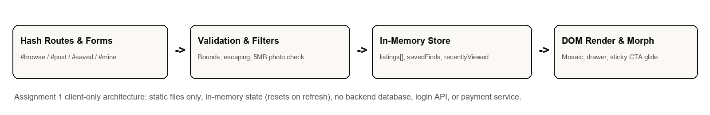

- **Runs in the browser**: hash routing (`#browse`, `#saved`, `#mine`, `#post`, `#edit/<id>`, `#listing/<id>`), filtering/sorting, mosaic row packing, native & JS form validation, HTML entity escaping, `FileReader` in-memory photo previews, and sticky scroll-morph interpolation.
- **Deferred to Assignments 2 & 3**: persistent SQLite/MySQL (`PDO`) and MongoDB storage, server-side validation and moderation approval workflows, session authentication / CSRF protection, real campus email checks, expiry automation, contact requests, and abuse reporting.

---

## Wireframes

| Desktop Browse Layout & Scroll-Morph Flow | Mobile Browse & Listing Form Wireframes |
| :---: | :---: |
| 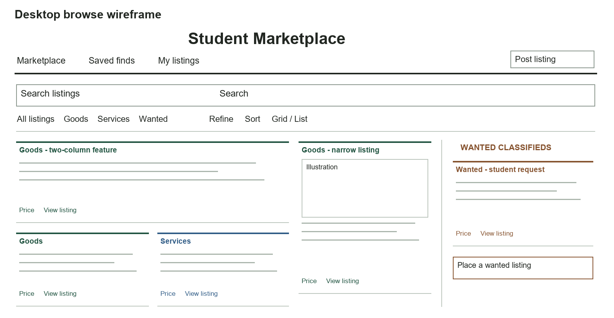 | 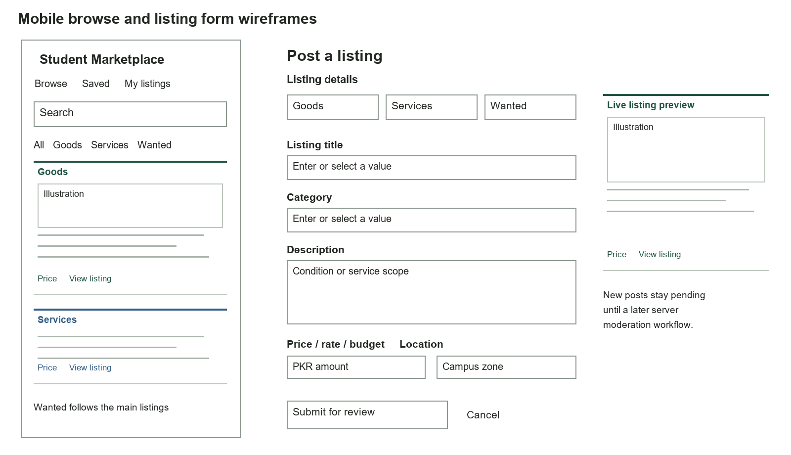 |

---

## Screenshots

Captured from the running static client in Chromium across desktop (`1440x900`, `1366x768`, `1280x800`), tablet (`768x1024`), and mobile (`390x844`) viewports with zero horizontal overflow and zero console errors.


| Desktop Filters Drawer | Scroll-End Wanted CTA Morph |
| :---: | :---: |
| 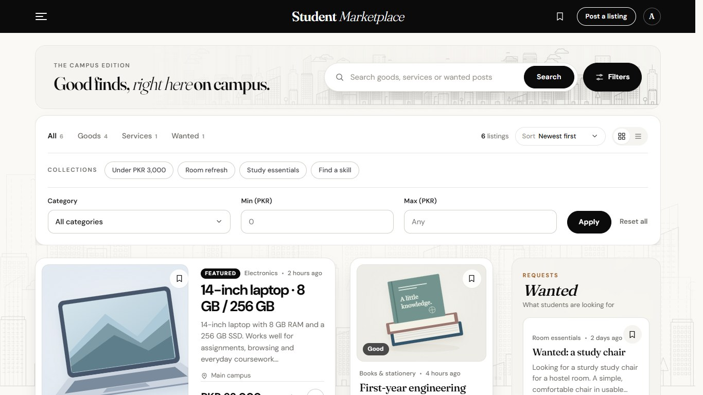 | 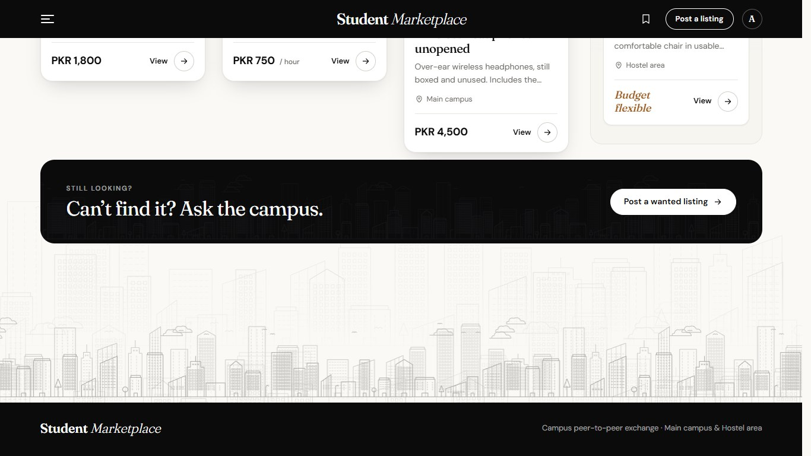 |

| Slide-Over Navigation Drawer | Post a Listing & Live Preview |
| :---: | :---: |
| 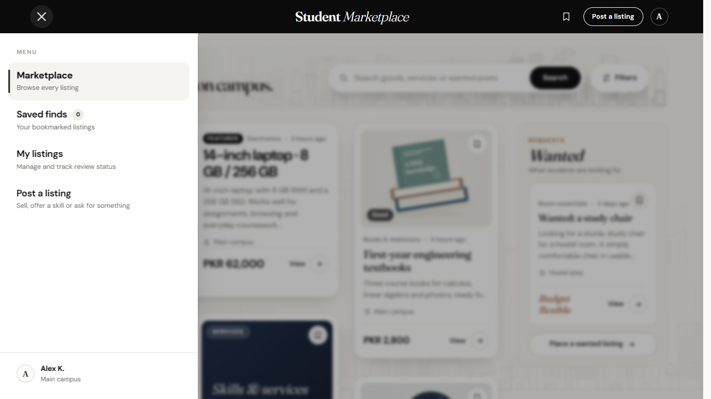 | 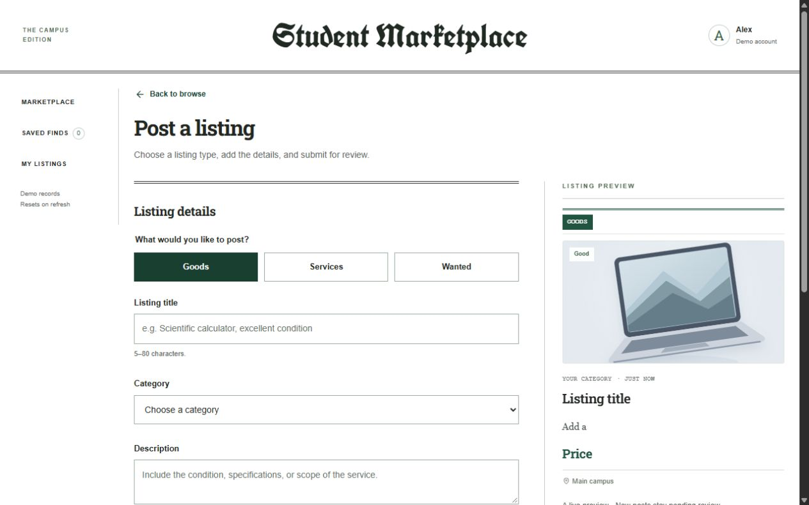 |

| My Listings Lifecycle States | Saved Finds Collection |
| :---: | :---: |
| 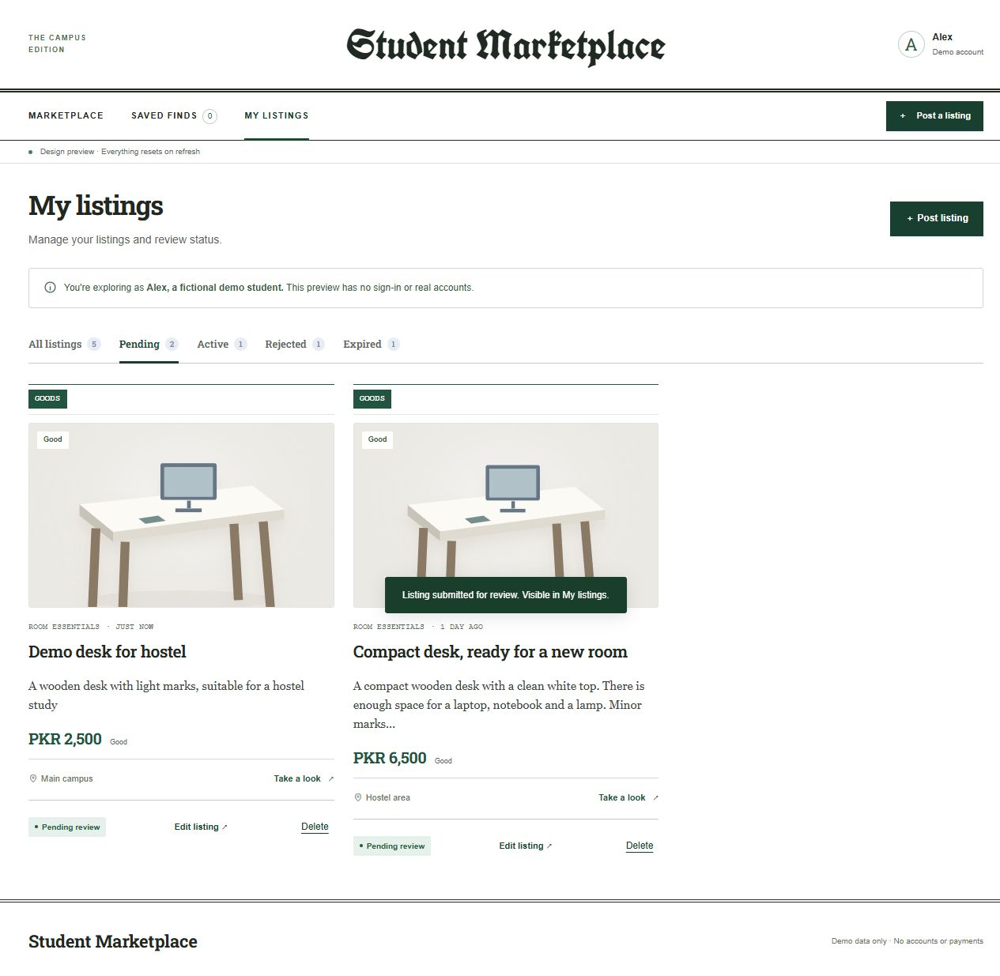 | 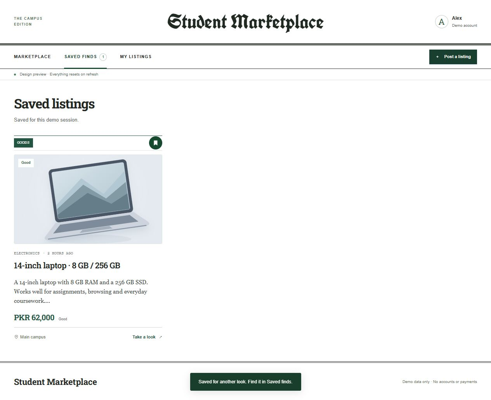 |

| Inline Form Validation | Tablet (`768x1024`) | Mobile (`390x844`) |
| :---: | :---: | :---: |
| 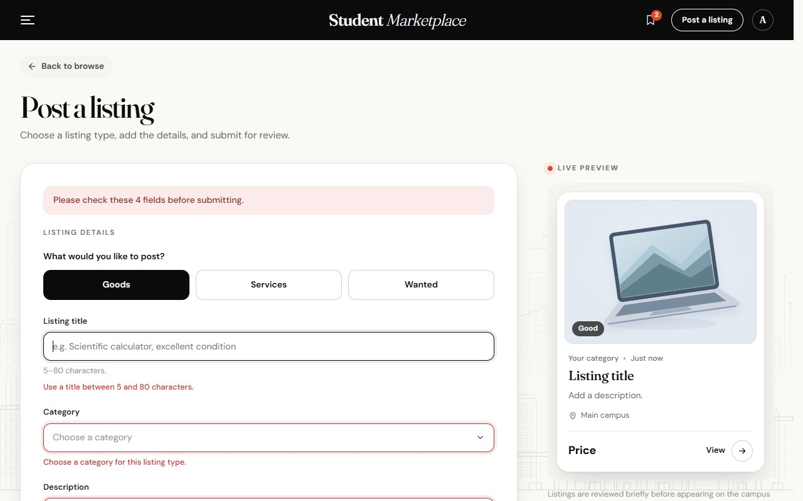 | 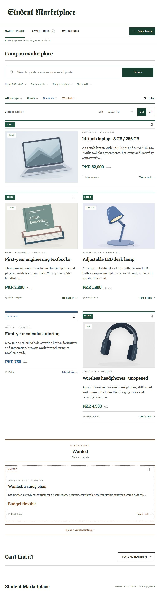 | 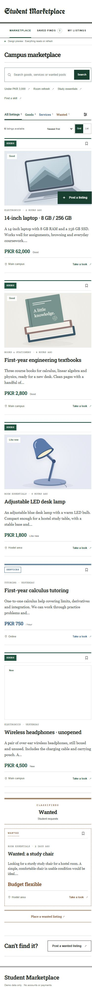 |

---

## Repository Layout

- `assignment-1/`: Runnable static frontend (`index.html`, `app.js`, `edition.js`, `navigation.js`, `premium.css`, local SVG artwork & bundled `assets/fonts/`).
- `tests/`: Automated DOM and workflow test suite (`tests/assignment-1.test.cjs` — 15 tests).
- `docs/`: Verification notes (`verification.md`), deployment notes (`deployment.md`), design lock (`design-lock.md`), asset attribution (`attribution.md`), wireframes (`docs/wireframes/`), and browser screenshots (`docs/screenshots/`).
- `tools/`: Python helper (`build_report.py`) for regenerating documentation wireframes and reports.
- `submission/`: Formatted assignment design note document (`.docx` / `.pdf`).

---

## Assets & Attribution

- Fonts are bundled locally under `assignment-1/assets/fonts/` (no external font CDN dependency): **Fraunces** and **DM Sans**, with SIL Open Font License notices included in `assignment-1/assets/fonts/` and details in [docs/attribution.md](docs/attribution.md).
- Custom SVG campus skyline (`assignment-1/assets/skyline.svg`) and 9 listing illustrations reside under `assignment-1/assets/`.
- AI coding assistance was used to structure, refine, audit, and test the interface, responsive CSS, documentation wireframes, and test suite under instructor guidelines for CS344 Assignment 1.

---

## Deploying Static Updates to Vercel

Only `assignment-1/` is deployed (no build step required):

```bash
vercel link --yes --project student-marketplace-cs344 --scope crankysmh47s-projects --cwd assignment-1
vercel deploy --prod --yes --scope crankysmh47s-projects --cwd assignment-1
```
