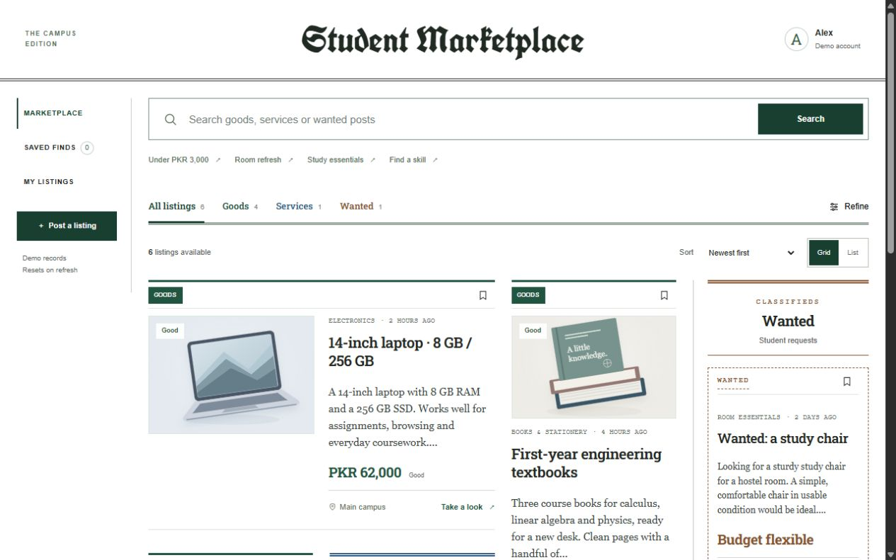

# Student Marketplace

CS344 Web Engineering, Assignment 1. Annan Khan, CMS 506644, BESE15-B. Assigned idea 16: Student Marketplace Listings.

A browser-only campus marketplace for goods, service offers and wanted goods. It uses semantic HTML, CSS and vanilla JavaScript, with no framework or backend. The approved newspaper design has white surfaces, compact editorial columns and separate Wanted classifieds.

## Run the application

Install Python 3, open a terminal in this repository, then run:

    py -m http.server 5519 --bind 127.0.0.1 --directory assignment-1

On macOS/Linux use python3 instead of py. Visit http://127.0.0.1:5519/?theme=forest#browse. Keep the terminal open. Stop it with Ctrl+C. Any static HTTP server may serve assignment-1; no database, secrets, npm build or account is required.

All listings and saves live in memory and reset on refresh. Alex is a fictional demo student. The app does not verify university membership, contact another person or process payments.

## Assigned rule and scope

The supplied project variant adds moderation, categories, saved items, contact requests, expiry and report-abuse flows using demo data and no payments. Assignment 1 implements listing discovery, categories, price/type filtering, in-memory listing CRUD and saved items. Pending/rejected/expired fixtures demonstrate lifecycle states. These states do not implement a moderator service, automatic expiry, contact requests or report resolution. Those are planned for the later assignments. No separate additional instructor rule was supplied beyond this description.

## Demonstrate the workflow

1. Browse Goods, Services and Wanted. Open Refine, select a category or price range, and apply it. Search for a title and try a query with no matches.
2. Open a listing, inspect its details, save it and visit Saved finds. Unsave it and check the empty view.
3. Post a listing. Try empty fields, then enter a title of 5-80 characters, a description of 20-1500 characters, a valid category and an amount of 0-1000000 PKR with up to two decimals.
4. Switch between goods, services and wanted. Services select a rate unit; wanted can use a flexible budget. Preview the entered content.
5. Submit. The new listing appears as Pending review in My listings, not in public browse. Edit and delete only an owned demo listing. Refresh to reset.

## Test

The app needs no Node dependencies to run. For development tests, use Node 20 or later and pnpm:

    pnpm install --frozen-lockfile
    pnpm test

Tests use Node's test runner and jsdom for DOM behavior. They do not render a browser or prove exact visual geometry. See docs/verification.md for scope and pending viewport checks.

## Files

- assignment-1: runnable client and local assets.
- tests: automated workflow and edge-case checks.
- docs/design-lock.md: final visual decisions and later-stage boundaries.
- docs/wireframes: desktop and mobile wireframes; these are schematics, not screenshots.
- submission: design and WDLC report for LMS.
- tools: document/wireframe generation helpers.

## Screenshots

Actual browser screenshots are included. Desktop (1280x800), tablet (768x1024) and mobile (390x844) checks found no horizontal overflow. Form validation, saved items and owner-listing views are also captured. These are agent-run checks, not evidence of the student's own live walkthrough.

- [Desktop browse](docs/screenshots/desktop-browse.jpg)
- [Tablet browse](docs/screenshots/tablet-browse.jpg)
- [Mobile browse](docs/screenshots/mobile-browse.jpg)
- [Listing form](docs/screenshots/listing-form.jpg)
- [Native validation](docs/screenshots/form-validation.jpg)
- [My listings and review states](docs/screenshots/my-listings.jpg)
- [Saved listings](docs/screenshots/saved-listings.jpg)

Browser automation stalled at a JavaScript Delete confirmation. The in-memory delete and cancel paths pass automated DOM tests; complete this one browser check during the live walkthrough.

## Assets and assistance

Local SVG listing illustrations were generated for this fictional demo. Font files and their upstream license notices are in assignment-1/assets/fonts. Font sources: google/fonts ofl/unifrakturcook, apache/robotoslab, ofl/librecaslontext, ofl/fraunces and ofl/dmsans. Some earlier font variants remain in the reference styles; the locked forest/newspaper view uses Unifraktur Cook and Roboto Slab.

The instructor's permission to use the generated preview was confirmed by the student on 26 October 2026. Annan will add the final AI assistance statement before submission. No claim is made that the original preview was developed test first; tests preceded the new validation and delete fixes.

## Assignment continuity

The current stage is preserved in assignment-1 and an assignment-1-v1.1 tag (the original v1.0 checkpoint is retained). Keep future PHP/PDO and MERN stages in separate assignment folders or branches. Consult docs/design-lock.md for shared product rules. The full-project rubric and final due date have not yet been supplied.
